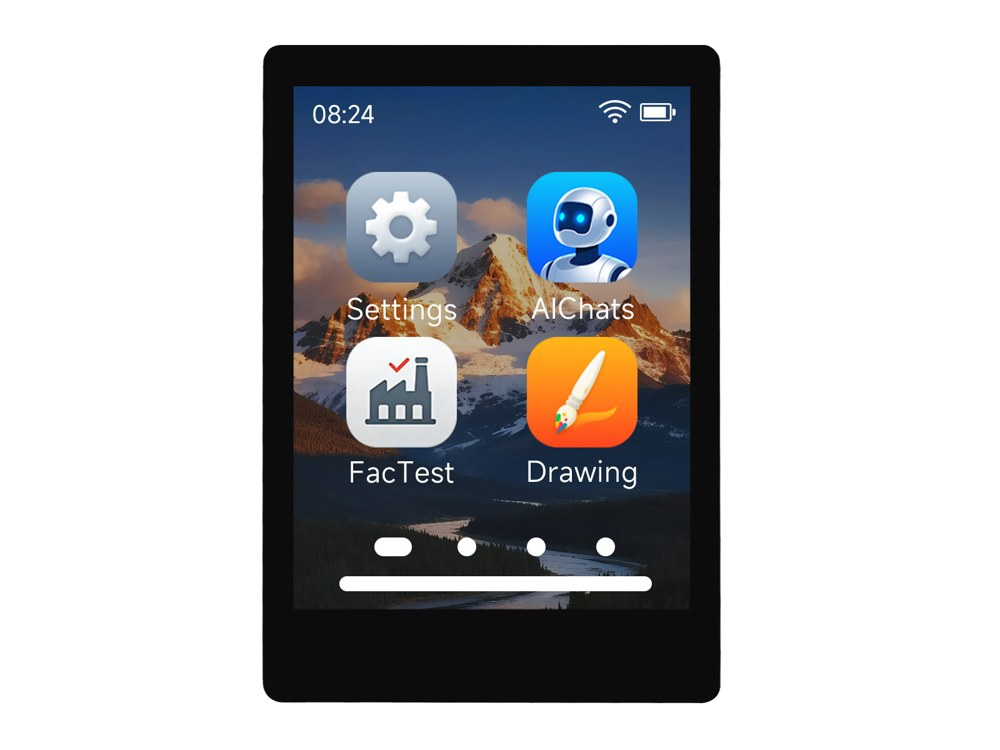

  <h1>ESP32-C5-Touch-LCD-2.8</h1>
  
<strong>2.8-inch 240 × 320 ESP32-C5 Wi-Fi 6 touch display development board</strong>

  
<strong>English</strong> | <a href="README_ZH.md">简体中文</a>

  

    
    
    
  

  

    <a href="https://www.waveshare.com/ESP32-C5-Touch-LCD-2.8.htm">🌐 Product</a> &middot;
    <a href="https://github.com/waveshareteam/ESP32-C5-Touch-LCD-2.8/releases/latest">📦 Firmware</a> &middot;
    <a href="examples/esp-idf/">🧩 ESP-IDF</a> &middot;
    <a href="examples/arduino/examples/">🔧 Arduino</a> &middot;
    <a href="hardware/">📚 Documentation</a>
  

  

---

## ✨ Overview

Examples and hardware resources for the ESP32-C5 touch display board, including LCD, touch, audio, SD card and sensors. CH32V003 provides IO expansion and backlight PWM control.

| Feature | Device / interface |
| --- | --- |
| MCU | ESP32-C5 |
| Memory | Schematic module: ESP32-C5-WROOM-1-N32R8, 32 MB Flash and 8 MB PSRAM; examples use a 16 MB Flash layout |
| Display | 2.8-inch ST7789 SPI LCD, 240 × 320 |
| Touch | CST3530, I2C |
| Audio | ES8311 codec and onboard microphone |
| Sensors | QMI8658 IMU, PCF85063 RTC, SHTC3 temperature/humidity |
| Expansion | CH32V003 IO expander, microSD over shared SPI |
| Board support | [BSP and compatibility notes](docs/compatibility.md) |

## 📦 Quick Start

1. Download the required example package from [Releases](https://github.com/waveshareteam/ESP32-C5-Touch-LCD-2.8/releases).
2. Extract it and install esptool with `python -m pip install esptool`.
3. Connect the board over USB.
4. Follow the flashing script and instructions included in that package, then reset the board.

Factory firmware: download the file whose name contains `FactoryOnly` from [`firmware`](firmware/) to restore the supplied demonstration.

## 🧪 Examples

### ESP-IDF

| Example | Main feature |
| --- | --- |
| [01_lvgl_demo](examples/esp-idf/01_lvgl_demo/) | LVGL widgets, touch and backlight |
| [02_sd_card](examples/esp-idf/02_sd_card/) | SD file write/read verification |
| [03_qmi8658](examples/esp-idf/03_qmi8658/) | Serial acceleration and angular velocity |
| [04_pcf85063](examples/esp-idf/04_pcf85063/) | RTC set/read |
| [05_shtc3](examples/esp-idf/05_shtc3/) | Serial temperature and humidity |
| [06_exio](examples/esp-idf/06_exio/) | Header EXIO6/7 and backlight PWM |
| [07_audio](examples/esp-idf/07_audio/) | Record three seconds and play through speaker |
| [08_battery_voltage](examples/esp-idf/08_battery_voltage/) | LCD/serial battery voltage and raw ADC |

### Arduino

| Example | Main feature |
| --- | --- |
| [01_exio](examples/arduino/examples/01_exio/) | CH32V003 IO expander |
| [02_I2C_qmi8658](examples/arduino/examples/02_I2C_qmi8658/) | IMU readings |
| [03_SD_Card](examples/arduino/examples/03_SD_Card/) | SD file operations |
| [04_I2C_pcf85063](examples/arduino/examples/04_I2C_pcf85063/) | RTC |
| [05_shtc3](examples/arduino/examples/05_shtc3/) | Temperature and humidity |
| [06_lvgl_demo](examples/arduino/examples/06_lvgl_demo/) | LCD, touch and backlight |
| [07_battery_voltage](examples/arduino/examples/07_battery_voltage/) | Battery voltage and raw ADC |

Libraries are bundled in [`examples/arduino/libraries`](examples/arduino/libraries/). Arduino uses LVGL 8.4; ESP-IDF and factory use LVGL 9.5.0.

### Factory Demo

The [factory project](examples/factory/) provides 12 applications: Display Test, Settings, AIChats, Touch Test, GravityBall, Photos, Weather, SD Music, Sensor, 2048, Mic Test and Button Test. AIChats runs inside the desktop firmware; see the [user guide](examples/factory/USER_GUIDE.md) for network setup, activation and application controls.

## 🛠️ Development Environment

The framework versions and board options are defined in [product.json](.github/product.json).

| Framework | Version | Examples |
| --- | --- | ---: |
| ESP-IDF | `v5.5.4` | 8 |
| ESP-IDF (factory project) | `v5.5.4` | 1 |
| Arduino-ESP32 | `3.3.12` | 7 |

Follow each example's README to build and flash. Each IDF project includes its own BSP and local drivers, keeps LCD DMA buffers in internal RAM and provides one ES8311 input/output handle.

Each basic example and the factory project is self-contained, with its own components directory and matching BSP interfaces. Copy a complete project directory to build it independently; build factory with the factory ESP-IDF version above.

## 📚 Resources

- [Schematic](hardware/schematic/)
- [Mechanical drawings and 3D model](hardware/mechanical/)
- [Product page](https://www.waveshare.com/ESP32-C5-Touch-LCD-2.8.htm)
- [Wiki](https://docs.waveshare.com/ESP32-C5-Touch-LCD-2.8)

## 🤝 Support

- Example or repository problem: [open an issue](https://github.com/waveshareteam/ESP32-C5-Touch-LCD-2.8/issues/new/choose).
- Product usage, hardware or order questions: [Waveshare support](https://service.waveshare.com/).

## 📄 License

Apache License 2.0. See [LICENSE](LICENSE).
