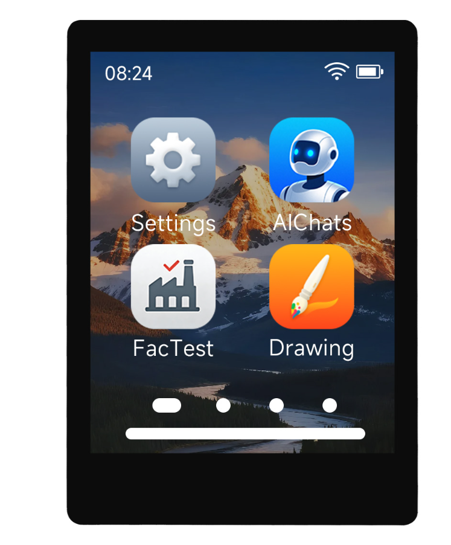

<div align="center">

<h1>ESP32-C5-Touch-LCD-2.8</h1>
<p><strong>2.8-inch ESP32-C5 Wi-Fi 6 touch display development board</strong></p>
<p><a href="LICENSE"></a></p>
<p>English | <a href="README_ZH.md">简体中文</a></p>
<p>
<a href="https://www.waveshare.com/ESP32-C5-Touch-LCD-2.8.htm">🌐 Product</a> |
<a href="https://docs.waveshare.com/ESP32-C5-Touch-LCD-2.8">📚 Documentation</a> |
<a href="Firmware/">📦 Firmware</a> |
<a href="examples/esp-idf/">🧩 ESP-IDF</a> |
<a href="examples/arduino/">🔧 Arduino</a>
</p>


</div>

---

## ✨ Overview

Examples and resources for evaluating the LCD, touch, sensors, SD card and audio on ESP32-C5-Touch-LCD-2.8. CH32V003 provides IO expansion, display/touch reset and backlight control; its firmware is programmed at the factory.

| Hardware | Details |
| :--- | :--- |
| MCU | ESP32-C5 |
| Display | 2.8-inch ST7789 LCD, 240 × 320 |
| Touch | CST3530, I2C address `0x58` |
| IO expander | CH32V003, I2C address `0x24` |
| Sensors | QMI8658 IMU, PCF85063 RTC, SHTC3 temperature/humidity |
| Audio | ES8311 codec |
| UI | LVGL 9 for ESP-IDF; bundled LVGL 8.4 for Arduino |

See the [hardware and component compatibility notes](docs/compatibility.md) before changing the BSP.

## 🧪 Build examples

The CI configuration targets ESP-IDF **v5.5.5 and v6.1** for all 8 IDF projects, and Arduino-ESP32 **3.3.12** for all 6 sketches. Configured coverage is not a claim that every build or hardware test has passed; check [validation status](docs/validation.md) and the current commit's Actions results.

### ESP-IDF

Activate the selected ESP-IDF environment, then run from the repository root:

```sh
python scripts/build_example.py esp-idf examples/esp-idf/02_2048
```

The helper uses a separate `build/<idf-version>/sdkconfig` derived from each example's defaults and leaves the checked-in configuration intact. To build and flash manually from an example directory:

```sh
idf.py set-target esp32c5
idf.py build flash monitor
```

| Example | Function |
| :--- | :--- |
| [01_ch32_test](examples/esp-idf/01_ch32_test/) | CH32V003 IO expander test |
| [02_2048](examples/esp-idf/02_2048/) | LVGL touch game |
| [03_sd_lvgl](examples/esp-idf/03_sd_lvgl/) | Read SD card text and display it |
| [04_sd_music](examples/esp-idf/04_sd_music/) | Play MP3 files from SD card |
| [05_spiff_music](examples/esp-idf/05_spiff_music/) | SPIFFS music player |
| [06_wifi_weather](examples/esp-idf/06_wifi_weather/) | Wi-Fi weather display |
| [07_Ball_qmi](examples/esp-idf/07_Ball_qmi/) | IMU-controlled ball |
| [08_bookesia](examples/esp-idf/08_bookesia/) | Brookesia touch application and drawing board |

### Arduino

Install Arduino-ESP32 3.3.12 and select **ESP32C5 Dev Module**, **16 MB flash**, **QIO**, **PSRAM enabled**, and **16M Flash (3MB APP/9.9MB FATFS)**. Keep the repository's bundled LVGL and SensorLib versions.

With Arduino CLI installed:

```sh
arduino-cli core update-index --additional-urls https://espressif.github.io/arduino-esp32/package_esp32_index.json
arduino-cli core install esp32:esp32@3.3.12 --additional-urls https://espressif.github.io/arduino-esp32/package_esp32_index.json
python scripts/build_example.py arduino examples/arduino/06_lvgl_demo
```

For Arduino IDE, copy the contents of [libraries](examples/arduino/libraries/) into your sketchbook's libraries directory. For the LVGL example, also copy [lv_conf.h](examples/arduino/06_lvgl_demo/lv_conf.h) beside the installed `lvgl` directory. The CLI helper supplies this configuration automatically.

| Example | Function |
| :--- | :--- |
| [01_exio](examples/arduino/01_exio/) | CH32V003 IO expander |
| [02_I2C_qmi8658](examples/arduino/02_I2C_qmi8658/) | IMU |
| [03_SD_Card](examples/arduino/03_SD_Card/) | SD card read/write |
| [04_I2C_pcf85063](examples/arduino/04_I2C_pcf85063/) | RTC |
| [05_shtc3](examples/arduino/05_shtc3/) | Temperature and humidity |
| [06_lvgl_demo](examples/arduino/06_lvgl_demo/) | LCD, touch, backlight and LVGL |

## 📂 Resources

| Directory | Contents |
| :--- | :--- |
| [examples/esp-idf](examples/esp-idf/) | IDF projects and shared board components |
| [examples/arduino](examples/arduino/) | Sketches and bundled libraries |
| [schematic](schematic/ESP32-C5-Touch-LCD-2.8.pdf) | Board schematic |
| [dimensions](dimensions/) | [PDF](dimensions/ESP32-C5-Touch-LCD-2.8.pdf), [DXF](dimensions/ESP32-C5-Touch-LCD-2.8.dxf), [STEP](dimensions/ESP32-C5-Touch-LCD-2.8.stp) |
| [guider_ui](guider_ui/) | GUI Guider project resources |
| [sdcard](sdcard/) | Test files, pictures and music |
| [Firmware](Firmware/) | Factory delivery image |

Examples formerly under `example/ESP-IDF-V554` and `example/Arduino-v3.3.10` now live under the framework-specific directories above.

For SD demos, use a FAT32 card (64 GB or smaller) and copy the required [sdcard assets](sdcard/) to its root. The SD music example expects a `music` directory containing MP3 files. Configure Wi-Fi credentials for the weather example before running it.

## 📦 Factory firmware

[FactoryApp V1.1](Firmware/ESP32-C5-Touch-LCD-2.8-FactoryAppV1.1.bin) restores the supplied demonstration. Follow the [product documentation](https://docs.waveshare.com/ESP32-C5-Touch-LCD-2.8) for flashing instructions.

The delivered image is maintained separately from example build CI. This repository update does not regenerate it.

## 🤝 Development and support

- [Contributing](CONTRIBUTING.md)
- [Support](SUPPORT.md)
- [CI behavior and local checks](docs/ci.md)
- [Components and hardware](docs/compatibility.md)
- [Validation status](docs/validation.md)

## 📄 License

First-party code is licensed under [Apache-2.0](LICENSE). Bundled dependencies retain their own licenses and notices.
